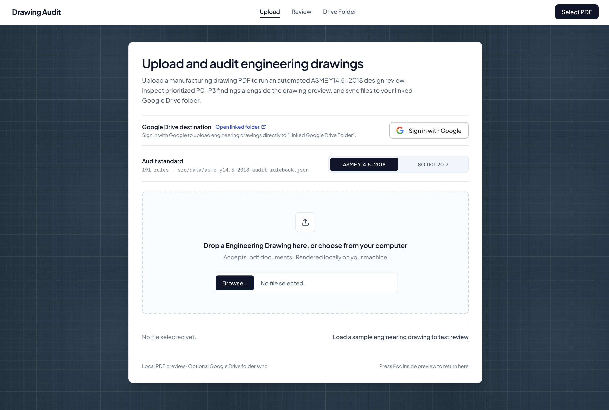
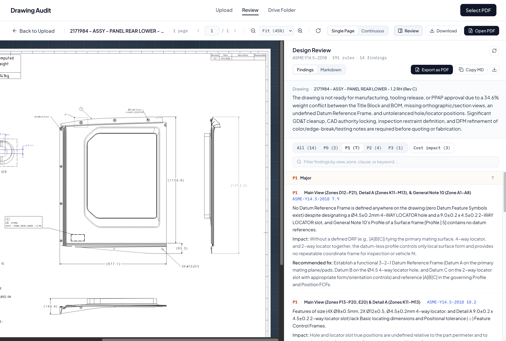

# Drawing Audit

**Drawing Audit** is a full-stack web application for pre-release manufacturing reviews of engineering drawing PDFs. It evaluates orthographic drawings and title blocks against machine-readable **ASME Y14.5-2018** (191 rules) and **ISO 1101:2017** (163 rules) rulebooks, categorizes actionable findings from **P0 (Blocker)** to **P3 (Suggestion)**, flags high-cost-impact design choices, and exports archival PDF and Markdown reports alongside an interactive drawing viewer.



---

## Why I Built This

Before a mechanical part goes out for quoting or machining, an engineer manually checks every sheet for missing datums, untoleranced features of size, title block conflicts, deprecated GD&T/ISO GPS syntax, and unnecessary cost drivers. Manual reviews are time-consuming and easy to rush under release pressure—and a single missed Datum Reference Frame or weight/BOM conflict can hold up tooling or scrap a prototype run.

**Drawing Audit** turns the standard rulebooks into structured, clause-cited review passes so engineers can catch blockers, standard violations, and DFM cost risks in a split preview-and-review workspace before release.

---

## Review Workspace

Once a PDF is uploaded, the application opens a side-by-side workspace pairing a local PDF.js drawing viewer with the structured **P0–P3 Design Review** panel:



- **Interactive Drawing Preview (Left):** Local `pdfjs-dist` canvas rendering with single-page and continuous scroll modes, zoom presets, 90° rotation, thumbnail rail, sheet navigation, and a browser native PDF viewer fallback. Clicking any finding jumps directly to its sheet number.
- **Structured P0–P3 Findings (Right):** General manufacturing readiness assessment, priority filters (`All`, `P0`, `P1`, `P2`, `P3`), a **Cost impact** toggle for high-price machining/tolerancing drivers, and live search across views, drawing zones, standard clauses, and keywords.
- **Export & Sharing:** Download a formatted multi-page **PDF report** (`Export as PDF`), copy clean **Markdown** directly into Google Docs (`Copy MD`), or download a `.md` file.

---

## End-to-End Workflow

```text
1. Select Standard & Upload PDF (Upload Tab)
   ├── Choose ASME Y14.5-2018 (191 rules) or ISO 1101:2017 (163 rules)
   ├── Drag-and-drop / select local .pdf (or load the built-in sample drawing)
   └── Optional: auto-upload PDF to a linked Google Drive folder (with overwrite check)
          │
          ▼
2. Client-Side Inspection & Transport (src/services/drawingAudit.ts)
   ├── pdfjs-dist reads page count & paper format locally in the browser
   ├── PDFs <= 14 MB: sent directly as base64 PDF to POST /api/audit
   └── PDFs > 14 MB: rasterized via pdfjs-dist into PNG pages (up to 10 pages)
          │
          ▼
3. Rulebook-Grounded Server Audit (server.ts)
   ├── Express loads both compiled JSON rulebooks once at server startup
   ├── Selects the active rulebook digest & builds standard-specific instructions
   ├── Sends drawing + rulebook to the Gemini API (@google/genai) with:
   │     • Strict JSON responseSchema (drawingName, generalAssessment, findings[])
   │     • High reasoning depth (ThinkingLevel.HIGH) and fixed seed (42)
   │     • Exponential-backoff retries on transient 429 / 5xx errors
   └── Normalizes, validates, sorts findings (P0 → P3), and builds Markdown output
          │
          ▼
4. Interactive Triage & Archival Export (Review Tab)
   ├── Inspect findings side-by-side with the rendered drawing
   ├── Filter by P0–P3 severity, Cost impact, or free-text search
   ├── Switch standards on the Upload tab and re-run with one click
   └── Export formatted A4 PDF report (jsPDF) or copy/download Markdown
```

---

## Rulebooks & Priority Classification

Instead of relying on vague generic prompts, the server injects a compiled, clause-cited JSON rulebook for whichever standard is selected on the Upload tab:

| Standard | Rulebook File | Total Rules | Mandatory (`SHALL`) | Recommended (`SHOULD`) | Defaults (`UOS` / ISO GPS) | Deprecated / Forbidden Checks |
|---|---|---:|---:|---:|---:|---:|
| **ASME Y14.5-2018** | `src/data/asme-y14.5-2018-audit-rulebook.json` | 191 | 127 | 29 | 35 | 41 |
| **ISO 1101:2017** | `src/data/iso-1101-2017-audit-rulebook.json` | 163 | 120 | 14 | 29 | 46 (incl. all 19 Annex A items) |

Each rule carries an exact citation ID (for example `ASME-Y14.5-2018 7.9` or `ISO-1101-2017 8.2.2.1.3`), enforcement level, visual/syntax triggers, pass/fail checks, and remediation guidance.

Findings are strictly categorized into four engineering priority tiers and formatted as `[Location/View/Zone]: Description -> Impact -> Recommended Fix`:

- **P0 (Critical / Blocker):** Fatal flaws—safety risks, impossible geometry, un-manufacturable features, or missing critical dimensions that prevent fabrication.
- **P1 (Major):** Functional risks—GD&T / ISO GPS errors, `SHALL_MANDATORY` standard violations, deprecated symbols, conflicting callouts, or missing tolerances.
- **P2 (Minor / Clarity):** Confusing layouts, overlapping lines, poor dimension placement, `SHOULD_RECOMMENDED` drafting gaps, or incomplete title block fields.
- **P3 (Suggestion):** Best-practice drafting improvements, DFM cost-reduction opportunities, or cleanup.

---

## Key Features

- **Dual-Standard Horizontal Slider:** Switch seamlessly between `ASME Y14.5-2018` and `ISO 1101:2017` on the Upload tab (persisted in `localStorage`).
- **High Cost Impact Flagging:** Explicitly tags design and tolerancing decisions that drive manufacturing cost (overly tight tolerances, unnecessary setups, exotic callouts) with a dedicated **Cost impact** filter.
- **Archival PDF Report Export (`src/utils/exportAuditPdf.ts`):** Generates a multi-page A4 engineering review PDF client-side via `jsPDF` with a header banner, drawing metadata, P0–P3 KPI summary boxes, General Assessment, page-break-safe finding cards, running headers/footers, and WinAnsi-safe normalization for GD&T/ISO symbols (`⌀`, `Ⓜ`, `Ⓔ`, `↔`, etc.).
- **Google Docs-Ready Markdown:** Switch to the `Markdown` tab, click `Copy MD` to paste directly into Google Docs with preserved headings and bullets, or download `.md`.
- **Optional Google Drive Sync:** Sign in with Google (Firebase Auth + client-side OAuth access token kept strictly in memory) to pick a destination folder and auto-upload drawings with explicit overwrite confirmation.

---

## Tech Stack

- **Frontend:** React 19, TypeScript, Vite 8, Tailwind CSS 4, `lucide-react`
- **PDF Viewing & Export:** `pdfjs-dist` (local canvas rendering & fallback rasterization), `jspdf` (structured PDF report export)
- **Backend:** Node.js, Express 4 (`tsx server.ts` in dev with Vite middleware; static `dist/` serving in production)
- **Analysis Engine:** `@google/genai` SDK (server-side `/api/audit` proxy—API key never exposed to the browser)
- **Optional Drive Integration:** `firebase` Auth + Google Drive REST API (`src/services/googleAuth.ts`, `src/services/googleDrive.ts`)

---

## Project Structure

```text
.
├── server.ts                                    # Express API (/api/audit, /api/health) & Vite/static host
├── src/
│   ├── App.tsx                                  # Upload tab, standard slider, Drive sync, workspace router
│   ├── index.css                                # Tailwind CSS v4 setup & mosaic blueprint background
│   ├── components/
│   │   ├── PdfPreviewWorkspace.tsx              # Split-screen PDF.js viewer & toolbar
│   │   ├── AuditReviewPanel.tsx                 # P0–P3 findings stream, filters, Markdown & PDF export
│   │   ├── DriveFolderModal.tsx                 # Google Drive folder picker modal
│   │   ├── ConfirmActionModal.tsx               # Overwrite confirmation dialog for Drive uploads
│   │   └── GoogleSignInButton.tsx               # Google sign-in button
│   ├── data/
│   │   ├── asme-y14.5-2018-audit-rulebook.json  # 191 compiled ASME Y14.5-2018 rules
│   │   └── iso-1101-2017-audit-rulebook.json    # 163 compiled ISO 1101:2017 rules
│   ├── services/
│   │   ├── drawingAudit.ts                      # Client upload/rasterize helper for POST /api/audit
│   │   ├── googleAuth.ts                        # Firebase Google sign-in (in-memory Drive token)
│   │   └── googleDrive.ts                       # Drive folder lookup & PDF upload helpers
│   ├── types/
│   │   └── audit.ts                             # Shared TypeScript types, standard configs, MD formatter
│   └── utils/
│       ├── exportAuditPdf.ts                    # Client-side A4 PDF report generator (jsPDF)
│       └── pdfHelpers.ts                        # pdfjs-dist worker setup, inspection & sample PDF
├── public/assets/aistudio/                      # Background tile & README screenshots (reference PDFs gitignored)
├── .env.example                                 # Required environment variables template
└── package.json
```

---

## Getting Started

### Prerequisites

- Node.js 20+
- A Gemini API key (`GEMINI_API_KEY`)

### Installation & Local Run

1. **Clone the repository and install dependencies:**
   ```bash
   git clone <your-repo-url>
   cd <your-repo-folder>
   npm install
   ```

2. **Configure environment variables:**
   Copy `.env.example` to `.env` and set your API key:
   ```bash
   cp .env.example .env
   ```
   ```env
   GEMINI_API_KEY="your_api_key_here"
   ```
   > **Note:** Check `MODEL_NAME` in `server.ts` if you want to target a specific Gemini model available to your API key.

3. **Start the development server (port 3000):**
   ```bash
   npm run dev
   ```
   Open [http://localhost:3000](http://localhost:3000). You can verify loaded rulebooks via:
   ```bash
   curl http://localhost:3000/api/health
   ```

4. **Type-check and build for production:**
   ```bash
   npm run lint
   npm run build
   NODE_ENV=production npm start
   ```

---

## Scope & Limitations

- **Engineering Sign-Off Required:** Drawing Audit is a pre-release review assistant, not a substitute for formal sign-off by a qualified mechanical or quality engineer. Always verify every finding directly against the drawing and applicable standards before manufacturing release.
- **Large Multi-Sheet PDFs:** Files larger than 14 MB are automatically rasterized in the browser up to 10 pages (`FALLBACK_MAX_PAGES` in `src/services/drawingAudit.ts`) to stay within request payload limits.
- **Standard PDFs Excluded:** Copyrighted ASME and ISO standard PDFs are not distributed in this repository (`public/assets/aistudio/*.pdf` is gitignored). The application runs entirely off the structured JSON rulebooks in `src/data/`.
---

## Next steps

- **Export format:** Create a overlay on the inmported drawing to be able to locate easily where the issues are located.
- **Bolted and welded assemblies:** Audit drawing on ISO-2553 (2019) & AWS A2.4 (2007) standards
- **Expand rulebook:** Expand rulebook outside of ISO and ASME standard, add material checker and BOM rules for assemblies.
